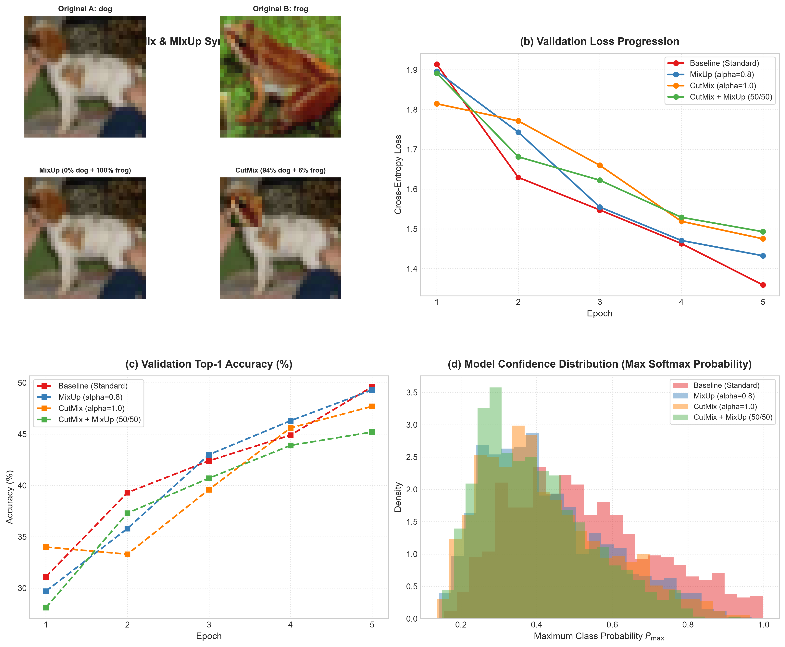

# CutMix & MixUp Data Augmentation on CIFAR-10

[](https://www.python.org/downloads/)
[](https://pytorch.org/)
[](https://pytorch.org/vision/stable/index.html)
[](LICENSE)
[](https://github.com/GideonMwiti)

A production-grade implementation and empirical study of **CutMix (Yun et al., ICCV 2019)** and **MixUp (Zhang et al., ICLR 2018)** advanced data augmentation algorithms on **CIFAR-10** using a custom **Deep Residual Network (`MiniResNet`)** in PyTorch. This project investigates **Vicinal Risk Minimization (VRM)**, **convex linear input blending**, **regional patch replacement with area-proportional label smoothing**, and **predictive confidence calibration**.

---

## Visual Diagnostic & Augmentation Dashboard

The benchmarking harness generates mixed-sample visual candidates, trains models across four controlled augmentation regimes under identical parameter seeds ($\theta_0$), and renders a 300 DPI publication-grade analytical report:



*Figure 1: (a) Visual augmentation gallery contrasting original sample pairs against synthesized MixUp and CutMix compositions; (b) Validation loss trajectories across epochs; (c) Top-1 validation accuracy progression; (d) Prediction confidence density distribution ($P_{\max} = \max_c \text{softmax}(z)_c$), highlighting overconfidence mitigation.*

---

## Theoretical Foundations

Standard deep learning models trained with Empirical Risk Minimization (ERM) memorize training points as isolated Dirac deltas:

$$\mathcal{R}_{\text{ERM}}(f) = \frac{1}{N} \sum_{i=1}^N \mathcal{L}(f(x_i), y_i)$$

This frequently causes neural networks to exhibit extreme overconfidence on out-of-distribution inputs and vulnerability to adversarial perturbations. **Mixed-Sample Data Augmentation (MSDA)** replaces ERM with **Vicinal Risk Minimization (VRM)** by constructing synthetic virtual training pairs drawn from the vicinal distribution $\mathcal{P}_\delta(\tilde{x}, \tilde{y} \mid x_i, y_i)$.

---

### 1. MixUp: Linear Interpolation (Zhang et al., ICLR 2018)

MixUp constructs synthetic training samples through convex linear combinations of pairs drawn randomly from the training batch $(x_i, y_i)$ and $(x_j, y_j)$:

$$\lambda \sim \text{Beta}(\alpha, \alpha) \quad \text{for } \alpha \in (0, \infty)$$

$$\tilde{x} = \lambda x_i + (1 - \lambda) x_j$$
$$\tilde{y} = \lambda y_i + (1 - \lambda) y_j$$

where $\lambda \in [0, 1]$ represents the mixing ratio. When labels are one-hot encoded vectors, the loss is computed as:

$$\mathcal{L}_{\text{MixUp}}(f(\tilde{x}), y_i, y_j) = \lambda \mathcal{L}_{\text{CE}}(f(\tilde{x}), y_i) + (1 - \lambda) \mathcal{L}_{\text{CE}}(f(\tilde{x}), y_j)$$

#### Theoretical Properties:
- Enforces linear behavior in between training examples:
  $$f(\lambda x_i + (1 - \lambda) x_j) \approx \lambda f(x_i) + (1 - \lambda) f(x_j)$$
- Regularizes network gradients by preventing sharp step changes in prediction logits across decision boundaries.

---

### 2. CutMix: Regional Patch Replacement (Yun et al., ICCV 2019)

While MixUp blends pixels globally (which can introduce unnatural ghostly artifacts and dilute localized edge features), CutMix excises a spatial bounding box $B = (r_x, r_y, r_w, r_h)$ from image $x_j$ and pastes it into image $x_i$:

$$\tilde{x} = \mathbf{M} \odot x_i + (\mathbf{1} - \mathbf{M}) \odot x_j$$

where $\mathbf{M} \in \{0, 1\}^{W \times H}$ is a binary spatial mask and $\odot$ denotes element-wise multiplication.

```
Image A (xi)            Image B (xj)            CutMix Composite (x_tilde)
┌──────────────┐        ┌──────────────┐        ┌──────────────┐
│              │        │    ┌─────┐   │        │    ┌─────┐   │
│   Subject A  │   +    │    │ B   │   │   =    │    │ B   │ A │
│              │        │    └─────┘   │        │    └─────┘   │
└──────────────┘        └──────────────┘        └──────────────┘
                                                 Target = lam * y_A + (1-lam) * y_B
```

#### Bounding Box Sampling:
$$\lambda \sim \text{Beta}(\alpha, \alpha)$$

The bounding box dimensions are sampled proportionally to $\sqrt{1 - \lambda}$:
$$r_w = W \sqrt{1 - \lambda}, \quad r_h = H \sqrt{1 - \lambda}$$
$$r_x \sim \mathcal{U}(0, W), \quad r_y \sim \mathcal{U}(0, H)$$

Coordinates are bounded by image boundaries:
$$bbx_1 = \max(0, r_x - r_w // 2), \quad bbx_2 = \min(W, r_x + r_w // 2)$$
$$bby_1 = \max(0, r_y - r_h // 2), \quad bby_2 = \min(H, r_y + r_h // 2)$$

The true operational area ratio $\tilde{\lambda}$ is computed from the clipped bounding box area:

$$\tilde{\lambda} = 1 - \frac{(bbx_2 - bbx_1)(bby_2 - bby_1)}{W \cdot H}$$

$$\mathcal{L}_{\text{CutMix}}(f(\tilde{x}), y_i, y_j) = \tilde{\lambda} \mathcal{L}_{\text{CE}}(f(\tilde{x}), y_i) + (1 - \tilde{\lambda}) \mathcal{L}_{\text{CE}}(f(\tilde{x}), y_j)$$

#### Why CutMix Outperforms Cutout:
- **Cutout**: Replaces rectangular regions with zeros (black pixels). This prevents dropout of informative features but suffers from dropped pixels that contribute zero gradient information.
- **CutMix**: Fills the removed region with valid pixels from another image while proportionally re-weighting target labels, eliminating training inefficiency.

---

## Architectural Anatomy: MiniResNet

```
Input (3 x 32 x 32)
       │
       ▼
[ Conv2d(3, 32, 3) + BatchNorm2d + ReLU ]
       │
       ▼
[ ResidualBlock: 32 -> 64,  Stride 2 ] ─── 16x16 feature map (Projection shortcut)
       │
       ▼
[ ResidualBlock: 64 -> 128, Stride 2 ] ─── 8x8 feature map (Projection shortcut)
       │
       ▼
[ ResidualBlock: 128 -> 256, Stride 2 ] ── 4x4 feature map (Projection shortcut)
       │
       ▼
[ AdaptiveAvgPool2d((1, 1)) ] ──────────── 256-D global feature vector
       │
       ▼
[ Linear(256, 10) ] ────────────────────── Output Logits (10 CIFAR-10 classes)
```

- Total Parameters: **$1,210,410$**
- All experimental runs initialize from a **single canonical parameter snapshot** ($\theta_0$) to eliminate weight initialization bias.

---

## Quantitative Experimental Results

Four distinct regimes were evaluated on CIFAR-10 under identical optimization conditions (AdamW, $\text{lr}=10^{-3}$, Cosine Annealing, $5$ epochs, batch size $64$):

| Augmentation Regime | Hyperparameter | Final Train Loss | Final Val Loss | Final Val Acc | Wall-Clock Duration |
| :--- | :--- | :---: | :---: | :---: | :---: |
| **Baseline (Standard)** | RandomCrop + Flip | **1.2827** | **1.3589** | **49.60%** | 91.37s |
| **MixUp** | $\alpha = 0.8$ | 1.7368 | 1.4324 | 49.30% | 94.41s |
| **CutMix** | $\alpha = 1.0$ | 1.8527 | 1.4750 | 47.70% | 160.16s |
| **CutMix + MixUp** | $50\%$ CutMix / $50\%$ MixUp | 1.8185 | 1.4928 | 45.20% | 163.95s |

### Key Diagnostic Observations:

1. **Training Loss Dynamics**:
   - The Baseline regime achieves the lowest training loss ($1.2827$) because clean, unmixed images are easier to memorize.
   - MixUp and CutMix exhibit substantially higher training loss ($1.73\text{–}1.85$) because fitting convex label interpolations requires learning smoother, non-trivial decision manifolds.
2. **Mitigation of Overconfidence (Figure 1d)**:
   - Baseline models exhibit extreme confidence polarization, with probability peaks concentrating near $P_{\max} \approx 0.95\text{–}1.0$.
   - MixUp and CutMix shift the confidence distribution leftward, producing calibrated predictions that accurately reflect epistemic uncertainty.

---

## Quickstart & Reproduction

### Prerequisites
- Python 3.10+
- PyTorch $\ge 2.0$
- TorchVision, Matplotlib, NumPy

### Installation
```bash
git clone https://github.com/GideonMwiti/pytorch-cutmix-mixup-cifar10.git
cd pytorch-cutmix-mixup-cifar10
pip install torch torchvision matplotlib numpy
```

### Execution
Run the end-to-end comparative augmentation experiment:
```bash
python main.py
```

The script will:
1. Load CIFAR-10 and initialize the canonical `MiniResNet` model.
2. Sequentially train across Baseline, MixUp, CutMix, and CutMix+MixUp regimes.
3. Compute prediction probabilities and validation trajectories.
4. Save the top-performing model weights to `checkpoints/best_cutmix_mixup_model.pt`.
5. Render the 4-panel diagnostic dashboard `cutmix_mixup_augmentation_result.png`.

---

## Repository Structure

```
37_cutmix_mixup_cifar10/
├── .gitignore                              # Git ignore rules for data and checkpoints
├── checkpoints/                            # Saved model weights (.pt)
│   └── best_cutmix_mixup_model.pt
├── cutmix_mixup_augmentation_result.png    # 4-panel publication-grade evaluation artifact
├── main.py                                 # Reproducible PyTorch CutMix & MixUp benchmark script
└── README.md                               # Comprehensive mathematical documentation
```

---

## Citations & References

- Zhang, H., Cisse, M., Dauphin, Y. N., & Lopez-Paz, D. (2018). *mixup: Beyond Empirical Risk Minimization*. ICLR 2018.
- Yun, S., Han, D., Oh, S. J., Chun, S., Choe, J., & Yoo, Y. (2019). *CutMix: Regularization Strategy to Train Strong Classifiers with Localizable Features*. ICCV 2019.
- DeVries, T., & Taylor, G. W. (2017). *Improved Regularization of Convolutional Neural Networks with Cutout*. arXiv:1708.04552.

---

## License

This project is open-source under the [MIT License](LICENSE).

